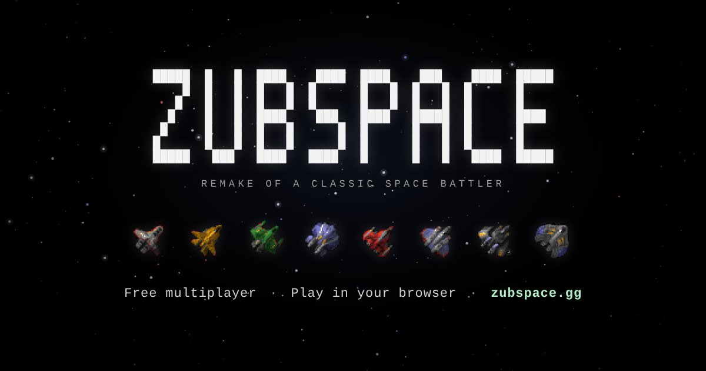

# Zubspace



**SubSpace, the 1997 online space shooter, rebuilt to play in your web browser.**

Play now at **[zubspace.gg](https://zubspace.gg)**. There's nothing to install: pick a pilot name, press Play, and you're flying.

## SubSpace

> SubSpace is a 2D space shooter video game created in 1995 and released in 1997
> by Virgin Interactive which was a finalist for the Academy of Interactive Arts &
> Sciences Online Game of the Year Award in 1998. SubSpace incorporates
> quasi-realistic zero-friction physics into a massively multiplayer online game.
>
> The game is no longer operated by VIE; instead, fans and players of the game
> provide servers and technical updates.
>
> — [Wikipedia, "SubSpace (video game)"](https://en.wikipedia.org/wiki/SubSpace_(video_game)), CC BY-SA 4.0

SubSpace was made by Burst (Jeff Petersen, Rod Humble and Juan Sanchez) for
Virgin Interactive. Its public beta opened in 1996, and its player counts
were unheard of for an online game at the time. When Virgin stopped running it, players
kept it alive. PriitK and Mr Ekted reverse-engineered a new client, Subspace
Continuum, first released in 2001. The community has been running zones like
Chaos and Extreme Games ever since.

Zubspace brings that game to the browser. It uses the original ships, sounds,
maps and zone settings, and the same physics: zero friction, momentum you have
to manage, and ships that bounce off walls.

## Why I made this

SubSpace is almost 30 years old. I played it as a kid, loved it, and never
stopped loving it. For a long time I wanted it to run in a web browser, so that
anyone could jump in and the game could live on.

In this era of AI and agentic engineering, I was lucky enough to be able to use
AI to help me rebuild it, so everyone can enjoy it again. Thank you for playing.
I hope you love it as much as I do.

-Peter


## Playing

Open [zubspace.gg](https://zubspace.gg) in a desktop browser (Chrome or
Firefox). You join the free-for-all Chaos zone with a few bots to fight
until other pilots arrive. 

The keyboard icon on the main menu (or `K` in the in-game menu) shows every
control. Two layouts work at the same time:

| | (Classic) Arrow keys | (Modern) WASD |
| --- | --- | --- |
| Turn and thrust | Arrow keys | `W` `A` `S` `D` |
| Afterburner | Hold `Shift` while thrusting | Hold `Shift` while thrusting |
| Guns | `X` or `Ctrl` | `,` |
| Bombs | `Z` or `Tab` | `.` |
| Mines | `Shift` + bomb key | `Shift` + `.` |
| Repel | `Q` | `/` |

| Key | Action |
| --- | --- |
| `1` – `0` | Burst, Rocket, Decoy, Brick, Thor, Stealth, Cloak, X-Radar, Antiwarp, Portal |
| `Shift` + `0` | Random warp |
| Hold `Space` | Player list |
| Hold `Alt` | Full map |
| `Enter` | Chat |
| `Esc` | Menu: `1`–`8` change ship, `S` spectate, `Q` leave |

The full list, including chat commands and spectating, is in
[docs/gameplay.md](docs/gameplay.md).

## How it works

- The game client is Rust compiled to WebAssembly and drawn with a fork of
  [Macroquad](https://github.com/not-fl3/macroquad). It loads the original
  SubSpace Continuum graphics, sounds, maps and LVZ art directly.
- The game server is an authoritative Rust server running at 60 ticks per
  second. It owns movement, weapons, damage, prizes, scoring and bots, and the
  client predicts your own ship so flying feels immediate.
- Browsers and the server talk over WebRTC DataChannels, with HTTP only for
  signaling and status. Snapshots are delta-encoded against what each player
  has acknowledged, and nearby ships are sent more often than distant ones.

Start with [docs/architecture.md](docs/architecture.md), then:

- [Networking](docs/networking.md): connection flow, channels, snapshots and events
- [Physics](docs/physics.md): shared movement, weapons, prediction and presentation
- [Server authority](docs/authoritative_server.md): what the server decides and how the client reconciles
- [Vendoring](docs/vendoring.md): renderer/runtime pairing and the WebRTC patches
- [Protocol compatibility](docs/protocol_compatibility.md): what follows Continuum and what is new
- [Gameplay](docs/gameplay.md): zones, ships, controls, bots and spawning
- [Deployment](docs/deployment.md) and [our servers](deploy/README.md)
- [Public API](docs/public-server-api.md) and [observability](docs/observability.md)

## Running it locally

You need [rustup](https://rustup.rs), Node.js 26 and `make`. Rustup picks up
the pinned toolchain in `rust-toolchain.toml`, including the WebAssembly target.

```sh
make start     # build the server and the WASM client, start both, print the URL
make restart   # rebuild and restart after a change
make stop      # stop both
```

Then open <http://127.0.0.1:7000/>. `make start` builds a debug client. Use
`make restart-local-release` to play the optimized build that ships to
zubspace.gg.

`make test-quick` runs the fast checks: formatting, the Node checks and the
native client and server tests.
The browser end-to-end suites are described in [tests/e2e/README.md](tests/e2e/README.md),
and the working notes for contributors and coding agents are in
[AGENTS.md](AGENTS.md).

## Thanks

- Burst and Virgin Interactive, for SubSpace.
- PriitK and Mr Ekted, for Subspace Continuum, and the players who have kept
  SubSpace zones running ever since.
- The Chaos and Extreme Games zones, whose maps, art and settings Zubspace ships with.
- [Macroquad](https://github.com/not-fl3/macroquad) and [webrtc-rs](https://github.com/webrtc-rs/webrtc).

## License

The Zubspace source code is [MIT licensed](LICENSE).

The game assets under `assets/` (graphics, sounds, maps and zones) come from the
original SubSpace and Subspace Continuum and their player community. They belong
to their original creators and are not covered by the MIT license. See
[ASSETS.md](ASSETS.md).
